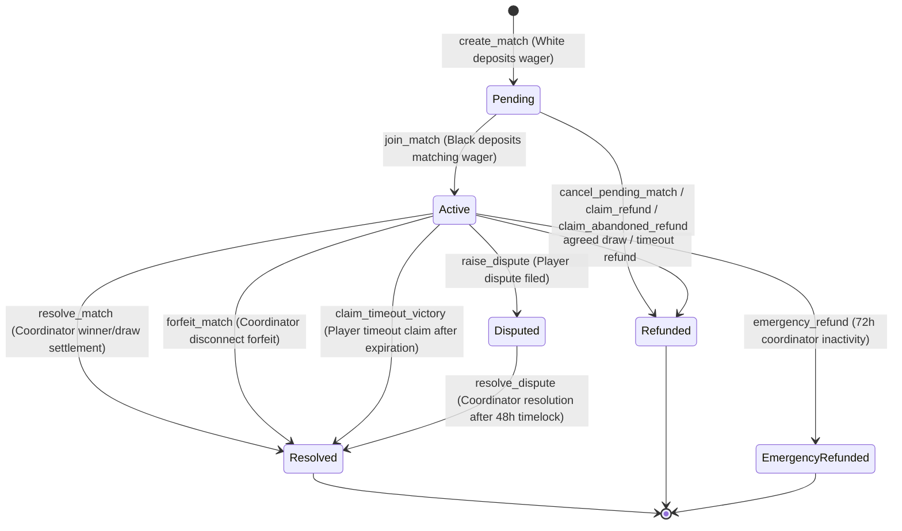

# Chesster Architecture

Chesster is a decentralized, real-time chess platform built on the **Stellar** network using **Soroban** smart contracts. The system enforces strict separation of concerns: off-chain backend infrastructure manages high-frequency move validation, low-latency clock synchronization, matchmaking, and disconnect grace intervals, while on-chain smart contracts maintain non-custodial token custody, wager locking, and trustless settlement.

---

## 1. High-Level Subsystem Architecture

The Chesster platform is organized into four core tiers: the **Client Tier**, **Backend Game Server**, **Data & Cache Tier**, and **Stellar / Soroban Blockchain**.

```mermaid
flowchart TB
    subgraph ClientTier["Client Tier (Web Browser)"]
        P1["White Player (Freighter Wallet)"]
        P2["Black Player (Freighter Wallet)"]
        Frontend["React + TypeScript Frontend\n(Vite, Zustand, chessground/chess.js)"]
    end

    subgraph BackendTier["Backend Game Server (Node.js / Express)"]
        API["Express REST API\n(Lobbies, Profiles, History, Metrics)"]
        WS["Socket.IO WebSocket Server\n(Game Rooms, Pings, Presence)"]
        ChessEngine["Chess Engine & Move Authority\n(Move Validation, Clock Management)"]
        TimerSvc["TimerService\n(Fischer Clocks, 60s Reconnect Grace Timers)"]
        CoordService["Escrow Coordinator Service\n(RPC Simulation, Fee Estimation, Settlement)"]
    end

    subgraph DataTier["Data & Persistence Tier"]
        DB[("Supabase / PostgreSQL\n(Games, Moves, Profiles, Audit Logs)")]
        RedisCache[("Redis Pub/Sub & Cache\n(Distributed Locks, Socket Adapters)")]
    end

    subgraph BlockchainTier["Stellar / Soroban Blockchain Tier"]
        RPC["Stellar RPC Node / Horizon\n(Testnet / Mainnet)"]
        Escrow["ChessterEscrow Smart Contract\n(Wagers, Lockups, Payouts, Forfeits)"]
        Tokens["Stellar Asset Contracts (SAC)\n(Native XLM, Whitelisted Tokens)"]
    end

    P1 <-->|UI / User Actions| Frontend
    P2 <-->|UI / User Actions| Frontend

    Frontend <-->|HTTPS / REST API| API
    Frontend <-->|WSS / Socket.IO\n(Moves, Heartbeats, State Sync)| WS

    WS <--> ChessEngine
    WS <--> TimerSvc
    API --> DB
    ChessEngine --> DB
    WS <--> RedisCache
    ChessEngine --> RedisCache

    Frontend -->|Signed Soroban Tx (Direct Invocation)\ncreate_match / join_match| RPC
    CoordService -->|Coordinator Tx (Settlement / Forfeit)\nresolve_match / forfeit_match| RPC
    RPC <--> Escrow
    Escrow <--> Tokens
```

### Component Responsibilities & Communication Protocols

| Component                                                                   | Role & Scope                                                                                                                                                                                                                                    | Communication Protocols                                                                                                                            |
| --------------------------------------------------------------------------- | ----------------------------------------------------------------------------------------------------------------------------------------------------------------------------------------------------------------------------------------------- | -------------------------------------------------------------------------------------------------------------------------------------------------- |
| **Frontend Client (`frontend/`)**                                           | React 19 + TypeScript single-page application. Manages UI state with Zustand, renders interactive chess boards with `chessground`, validates local client-side input with `chess.js`, and interacts with browser wallet extensions (Freighter). | • **HTTPS** to REST endpoints<br>• **WSS (Socket.IO)** for real-time game events<br>• **JSON-RPC** via `@stellar/stellar-sdk` to Stellar RPC nodes |
| **Backend API & WebSockets (`backend/`)**                                   | Node.js + Express application orchestrating match lobbies, authentication, spectator chat, leaderboard caching, and WebSockets rooms (`Socket.IO`). Authoritative source of game logic.                                                         | • **HTTPS** exposing `/api/games`, `/api/users`<br>• **Socket.IO** rooms per `gameCode`<br>• **TCP / TLS** to Supabase PostgreSQL and Redis        |
| **Move Authority & Timer Service (`backend/services/`, `backend/socket/`)** | Validates legal chess moves on the server side, calculates monotonic clock decrements with Fischer time increments, detects turn expirations (flag falls), and tracks player connectivity.                                                      | • Internal Node.js event bus & Redis pub/sub<br>• Monotonic high-resolution clock (`process.hrtime.bigint()`)                                      |
| **Coordinator Service (`backend/services/escrowService.js`)**               | Operational agent authorized to trigger contract settlement transactions (`resolve_match`, `forfeit_match`). Automatically calculates simulated Soroban gas fees and performs exponential backoff retries.                                      | • **Stellar RPC (`soroban-rpc`)** for transaction simulation, fee bumping, and transaction polling                                                 |
| **Database & Cache (`Supabase / Redis`)**                                   | PostgreSQL stores historical matches, FEN snapshots, move lists, user ratings, and match audit logs. Redis manages WebSocket distributed pub/sub adapters, rate-limit buckets, and distributed lock leases.                                     | • **PostgreSQL wire protocol (Port 5432)**<br>• **Redis RESP protocol (Port 6379)**                                                                |
| **Escrow Smart Contract (`contracts/soroban/contracts/escrow/`)**           | Rust-based Soroban smart contract (`ChessterEscrow`). Enforces non-custodial token custody, match state transitions, protocol fee collection, multisig administrative controls, and emergency refund fallbacks.                                 | • **Soroban Smart Contract Invocation** over Stellar Network (XDR transactions)                                                                    |

---

## 2. Wager Match Lifecycle

The wager match lifecycle spans lobby initialization, direct on-chain deposit by each player, turn-based move execution with clock updates, and final escrow settlement.

```mermaid
sequenceDiagram
    autonumber
    actor W as White Player
    participant WF as White Frontend / Wallet
    participant API as Backend REST / WebSocket
    participant DB as Supabase DB
    participant C as ChessterEscrow (Soroban)
    participant BF as Black Frontend / Wallet
    actor B as Black Player

    %% 1. Lobby Creation & White Escrow Deposit
    rect rgb(240, 248, 255)
    Note over W,C: Phase 1: Lobby Creation & Escrow Deposit
    W->>WF: Click "Create Game" (e.g., 10 XLM wager, 10+0 Rapid)
    WF->>API: POST /api/games (Create lobby payload)
    API->>DB: Insert game record (status: pending, gameCode)
    API-->>WF: 201 Created (gameCode, lobby details)
    WF->>C: create_match(gameCode, wagerAmount, token) [Signed via Freighter]
    C-->>C: Lock White's wager; status = Pending; emit MatchCreated
    C-->>WF: Tx confirmed on ledger
    WF->>API: Join Socket.IO room (gameCode)
    end

    %% 2. Opponent Join & Black Escrow Deposit
    rect rgb(245, 255, 245)
    Note over B,C: Phase 2: Opponent Join & Match Activation
    B->>BF: Enter gameCode in client / Select match lobby
    BF->>API: POST /api/games/:code/join
    API->>DB: Assign Black player to match record
    BF->>C: join_match(gameCode) [Signed via Freighter]
    C-->>C: Lock Black's wager; status = Active; emit MatchJoined
    C-->>BF: Tx confirmed on ledger
    BF->>API: Join Socket.IO room (gameCode)
    API->>DB: Update game status = active
    API-->>WF: Socket.IO event: player-joined (match ready)
    API-->>BF: Socket.IO event: player-joined (match ready)
    end

    %% 3. Move Loop & Clock Synchronization
    rect rgb(255, 255, 240)
    Note over W,B: Phase 3: Move Loop & Clock Synchronization
    loop For Each Turn
        W->>WF: Move piece on board (e.g., e2 -> e4)
        WF->>API: Socket.IO: make-move { gameCode, move, clientTimestamp }
        API->>API: Move Authority: validate legal move & update Fischer clock
        API->>DB: Append move to database & update current FEN
        API-->>WF: Broadcast game-update (FEN, clocks, turn, lastMove)
        API-->>BF: Broadcast game-update (FEN, clocks, turn, lastMove)

        B->>BF: Move piece on board (e.g., e7 -> e5)
        BF->>API: Socket.IO: make-move { gameCode, move, clientTimestamp }
        API->>API: Move Authority: validate legal move & update Fischer clock
        API->>DB: Append move to database & update current FEN
        API-->>WF: Broadcast game-update (FEN, clocks, turn, lastMove)
        API-->>BF: Broadcast game-update (FEN, clocks, turn, lastMove)
    end
    end

    %% 4. Result Settlement
    rect rgb(255, 240, 245)
    Note over W,C: Phase 4: Match Resolution & Escrow Settlement
    W->>WF: Delivers checkmate / Opponent resigns / Agreed draw
    WF->>API: Socket.IO move triggers terminal game state
    API->>DB: Update game: status = finished, winner = white
    API->>API: Escrow Coordinator: simulate gas fee & build resolve transaction
    API->>C: resolve_match(gameCode, winnerAddress) [Coordinator Signed]
    C-->>C: Deduct platform fee; transfer locked pool to winnerAddress
    C-->>API: Tx confirmed on ledger (MatchResolved event)
    API->>DB: Update escrow_status = settled, store settlement txHash
    API-->>WF: Socket.IO: game-over (winner: white, txHash)
    API-->>BF: Socket.IO: game-over (winner: white, txHash)
    end
```

---

## 3. Disconnect & Forfeit Recovery Protocol

In real-time online chess, network drops, closed browsers, and mobile sleep states must be handled gracefully without instantly penalizing players, while preventing malicious stalling.

Chesster implements a two-stage disconnect recovery protocol:

1. **Off-Chain 60-Second Reconnect Grace Window**: When a player drops their WebSocket connection, a server-side timer (`TimerService`) starts a 60-second grace countdown (`RECONNECT_GRACE_SECONDS = 60`). If the disconnected player reconnects within the window, the game state and monotonic clocks resume seamlessly.
2. **Coordinator Forfeit Settlement & Autonomous On-Chain Claims**: If the disconnected player fails to reconnect within 60 seconds, the game server declares an auto-forfeit. The server coordinator submits an on-chain forfeit transaction (`forfeit_match`). If the coordinator is offline or fails to settle, on-chain autonomous mechanisms (`claim_timeout_victory` and `emergency_refund`) protect user funds.

```mermaid
sequenceDiagram
    autonumber
    actor W as White Player (Active)
    participant WF as White Frontend
    participant Svr as Backend Server (Socket.IO + TimerService)
    participant DB as Supabase DB
    participant C as ChessterEscrow (Soroban)
    participant BF as Black Frontend
    actor B as Black Player (Disconnected)

    %% Disconnection Event
    Note over B,Svr: Stage 1: Disconnection Detection & Grace Countdown
    B-xBF: Network loss / Browser tab closed / 2 missed heartbeats
    BF-xSvr: WebSocket connection dropped
    Svr->>Svr: TimerService: start 60s reconnect grace timer
    Svr->>DB: Log disconnect event in match_audit_logs
    Svr-->>WF: Socket.IO event: player-disconnected (graceSeconds: 60)
    WF-->>W: Display opponent reconnect countdown banner

    %% Path A: Reconnect before grace timeout
    alt Path A: Player Reconnects Within 60s
        B->>BF: Connection restored / Client reloaded
        BF->>Svr: Socket.IO: reconnect-game { gameCode, playerToken }
        Svr->>Svr: TimerService: cancel reconnect grace timer
        Svr->>DB: Fetch latest game snapshot & active clock state
        Svr-->>BF: Socket.IO: reconnect-success (board FEN, clock state, move list)
        Svr-->>WF: Socket.IO: player-reconnected
        Note over W,B: Game resumes normal turn loop

    %% Path B: Grace Period Timeout (Server Auto-Forfeit)
    else Path B: Grace Period Expires (Auto-Forfeit Settlement)
        Note over Svr,C: Stage 2: Auto-Forfeit & Coordinator Settlement
        Svr->>Svr: 60s grace timer expires without reconnection
        Svr->>DB: Update game: status = finished, winner = white, end_reason = disconnect
        Svr-->>WF: Socket.IO event: game-over (winner: white, reason: disconnect)
        Svr->>API: Trigger _settleEscrow with endReason="disconnect"
        Svr->>C: forfeit_match(gameCode, forfeitingPlayer: blackAddress) [Coordinator Signed]
        C-->>C: Verify caller == coordinator; verify match active; status = Resolved
        C-->>W: Transfer locked wager pool (minus protocol fee) to White Player
        C-->>Svr: Tx confirmed on ledger (MatchForfeited event)
        Svr->>DB: Update escrow_status = settled, store txHash

    %% Path C: Fallback / Autonomous On-Chain Recovery
    else Path C: Coordinator Unavailable (Autonomous Recovery)
        Note over W,C: Stage 3: Direct On-Chain Player Recovery Fallbacks
        opt Match Expiration Exceeded (claim_timeout_victory)
            Note over W,C: Match duration > MATCH_EXPIRATION_SECS (1 hour)
            W->>WF: Trigger "Claim Timeout Victory" via UI
            WF->>C: claim_timeout_victory(gameCode, claimant: whiteAddress) [White Signed]
            C-->>C: Verify expiration elapsed; award pool to White Player
        end
        opt Coordinator Inactive for 72 Hours (emergency_refund)
            Note over W,C: No coordinator settlement for EMERGENCY_TIMEOUT_SECONDS (72 hours)
            W->>WF: Trigger "Emergency Split Refund" via UI
            WF->>C: emergency_refund(gameCode) [Signed by either White or Black]
            C-->>C: Verify 72 hours elapsed; status = EmergencyRefunded
            C-->>W: Refund 50% of total locked wager to White Player
            C-->>B: Refund 50% of total locked wager to Black Player
        end
    end
```

---

## 4. Escrow State Transitions

The Soroban `ChessterEscrow` contract manages the on-chain match lifecycle using discrete, audited state transitions:



### Stored Match Status Values

- **`Pending (0)`**: Player 1 (White) created the match and locked their wager. Awaiting Player 2 deposit.
- **`Active (1)`**: Player 2 (Black) joined and deposited matching funds. Match is underway.
- **`Resolved (2)`**: Match concluded and settled (via regular resolution, forfeit, or timeout claim). Winnings distributed.
- **`Refunded (3)`**: Match cancelled or declared draw; locked wagers refunded to participants.
- **`EmergencyRefunded (4)`**: Fail-safe escape hatch triggered after 72 hours of coordinator inactivity, splitting the pot equally between participants.
- **`Disputed`**: A separate dispute record that temporarily blocks standard settlement until the 48-hour timelock elapses for coordinator review.

For complete contract storage structures, error codes, and local sandbox deployment instructions, refer to the [Soroban Escrow Integration Guide](./SOROBAN_INTEGRATION.md).

---

## 5. Trust Boundaries & Security Model

1. **Non-Custodial Wager Deposits**: Neither the game server nor the coordinator has private keys to player wallets. Players deposit funds directly to the Soroban contract via Freighter wallet signatures.
2. **Coordinator Role & Scoped Authority**: The coordinator key is restricted to game adjudication actions (`resolve_match`, `forfeit_match`, `resolve_dispute`). The contract enforces that the coordinator can only select a winner from the actual registered match participants (`m.player1` or `m.player2`).
3. **Double-Spend & Sequence Protection**: The backend coordinator uses simulated Soroban resource estimation and transaction retries to handle sequence-number races (`tx_bad_seq`) and fee fluctuations.
4. **State Snapshot Reconciliations**: In-memory clock states and board positions are persisted to PostgreSQL after every move. Socket reconnects fetch the authoritative database FEN snapshot rather than trusting client-reported states.
5. **Decentralized Escape Hatches**: In the event of catastrophic backend infrastructure failure, users never lose access to their funds:
   - Pending matches can be reclaimed via `claim_refund` or `claim_abandoned_refund`.
   - Expired active matches can be claimed via `claim_timeout_victory`.
   - Unresolved active matches can be reclaimed after 72 hours via `emergency_refund`.
