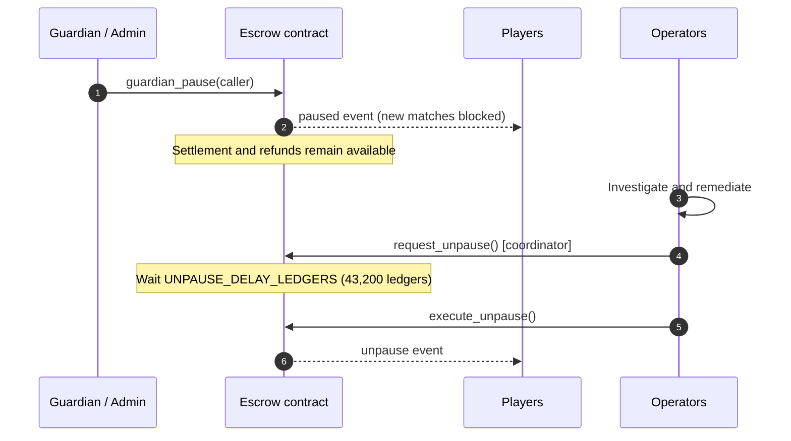
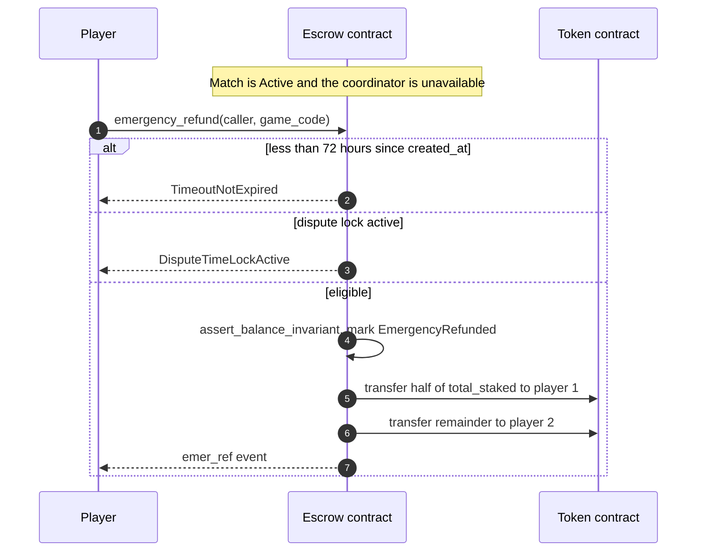

# Soroban Escrow Security Model and Threat Analysis

This document describes the security model of the Chesster escrow contract
(`contracts/soroban/contracts/escrow/src/lib.rs`, contract type `ChessterEscrow`):
who can do what, which invariants the contract enforces, how it handles the main
threats, and which procedures operators follow in an incident.

It describes the code as it exists in this repository. Where the implementation
differs from what a reader might assume, this document says so (see
[Known gaps and observations](#known-gaps-and-observations)). For general component
and lifecycle diagrams see [ARCHITECTURE.md](ARCHITECTURE.md); for storage layout and
the error catalog see [SOROBAN_INTEGRATION.md](SOROBAN_INTEGRATION.md).

## Contents

1. [Scope and assets](#scope-and-assets)
2. [Roles and trust assumptions](#roles-and-trust-assumptions)
3. [Security invariants](#security-invariants)
4. [Threat analysis](#threat-analysis)
5. [Emergency procedures](#emergency-procedures)
6. [Known gaps and observations](#known-gaps-and-observations)
7. [Reference: timing constants](#reference-timing-constants)

## Scope and assets

In scope: the on-chain escrow contract and its interaction with Stellar token
contracts (SAC or SEP-41 tokens). Out of scope: the backend, the frontend, wallet
software, and the token contracts themselves, which are trusted to implement the
SEP-41 interface honestly (see [Trust assumptions](#trust-assumptions)).

Assets the contract protects:

| Asset                      | Where it lives                 | Notes                                               |
| -------------------------- | ------------------------------ | --------------------------------------------------- |
| Player wagers              | Contract token balance         | Deposited with `create_match` / `join_match`.       |
| Spectator side bets        | Contract token balance         | Placed with `place_side_bet`.                       |
| Tournament buy-ins         | Contract token balance         | Deposited with `join_tournament`.                   |
| Protocol fees              | Treasury vault or coordinator  | Paid out at settlement, not held by the contract.   |
| Coordinator authority      | Coordinator account (and keys) | Controls settlement, configuration, pause, upgrade. |

## Roles and trust assumptions

The contract has no separate "master admin" account. Administrative authority is held
by the **coordinator** address set in `init`, and is widened or narrowed by a small
number of optional roles.

| Role                  | How it is set                                           | What it can do                                                                                                                                                                                                                                 |
| --------------------- | ------------------------------------------------------- | ---------------------------------------------------------------------------------------------------------------------------------------------------------------------------------------------------------------------------------------------- |
| Coordinator           | `init(coordinator, admin_bps)`; rotated by multisig     | Everything below: resolve matches, pause and unpause, configure fees and wager limits, whitelist tokens, set guardian and multisig admins, authorize migration and drain, upgrade the WASM. Every call requires `coordinator.require_auth()`. |
| Coordinator signature | `set_coordinator_pubkey(pubkey)`                        | An Ed25519 signature over a `MatchResolutionPayload` lets anyone submit a settlement through `resolve_match_with_signature`. The submitter needs no special role.                                                                              |
| Pause guardian        | `set_pause_guardian(address)`                           | `guardian_pause` only. The guardian can halt new activity but cannot unpause, move funds, or change configuration.                                                                                                                             |
| Multisig pause admins | `set_multisig_admins(a1, a2, a3)`                       | Any 2 of 3 can execute a pause (`propose_pause` + `confirm_pause`) or an unpause (`propose_unpause` + `confirm_unpause`).                                                                                                                      |
| Rotation signers      | `add_admin_signer` / `remove_admin_signer`              | Any 2 approvals via `propose_coordinator_rotation` / `approve_coordinator_rotation` replace the coordinator. The initial coordinator is the first signer.                                                                                       |
| Arbiters              | `set_arbiters`                                          | Propose and approve dispute resolutions (`propose_dispute_resolution`, `approve_dispute_resolution`).                                                                                                                                          |
| Players               | Anyone who creates or joins a match                     | Self-custody of their own wager: create, join, request cancellation or draw, propose and confirm mutual cancellation, claim timeout victory, and trigger an emergency refund. Each call requires the player's own `require_auth()`.         |
| Spectators            | Anyone                                                  | Place side bets on an active match and claim winnings or refunds. Require their own `require_auth()`.                                                                                                                                          |

### Trust assumptions

- **The coordinator is a trusted operator, not a trustless party.** It decides match
  outcomes (directly through `resolve_match`, or by signing payloads) and can change
  fees (within caps), pause the contract, and upgrade the contract code. A compromised
  coordinator key can settle matches to the wrong winner and can schedule a drain.
  Players are protected from the *worst* outcomes by the timelocks and caps below, not
  from a malicious coordinator in general. Treat the coordinator key as the highest
  value secret in the system and protect it accordingly (hardware wallet or HSM,
  rotation via multisig, no reuse).
- **Winner selection is restricted.** `settle_match` rejects any winner who is not
  `player1` or `player2` of the match (`InvalidWinner`), so even a coordinator cannot
  pay a match pot to a third party through the normal settlement path.
- **Tokens are trusted to follow SEP-41.** The contract calls `transfer`,
  `transfer_from`, `balance` and `allowance`. A malicious or non-conforming token
  could misreport balances. Only whitelisted tokens (`add_whitelisted_token`,
  `add_supported_token`) are accepted for wagers.
- **The ledger clock is trusted.** Timeouts compare against `env.ledger().timestamp()`
  and ledger sequence numbers, which validators set within the network's bounds.

## Security invariants

### 1. Solvency

For every token, the contract's actual balance must be at least the amount it
believes is locked:

```text
token.balance(contract)  >=  locked(token)
```

`locked(token)` is a per-token counter. It increases when wagers, side bets, or
tournament buy-ins are deposited (`deposit_wager`, `add_locked`) and decreases when
funds are paid out or refunded (`sub_locked`). `assert_balance_invariant` checks the
inequality before and after every settlement, refund, cancellation, side-bet claim,
and tournament payout, and aborts with `EscrowError::InvariantViolated` if it fails.
Because Soroban reverts the whole transaction on a panic, a violating operation leaves
no partial state behind.

The counter tracks escrowed player funds. Protocol fees are transferred out to the
treasury vault (or coordinator) at settlement time rather than accumulating in the
contract, so they do not appear in `locked`.

### 2. Authorization

Every state-changing entry point that moves funds or changes configuration calls
`require_auth()` on the relevant address:

- coordinator-only operations authenticate the stored coordinator;
- player operations authenticate the acting player and additionally check that the
  player belongs to the match (`UnauthorizedPlayer`);
- multisig operations authenticate the caller and check membership in the configured
  admin or signer set (`UnauthorizedSigner`).

Two entry points are deliberately callable by anyone, and are safe for different
reasons:

- `resolve_match_with_signature` authenticates through the coordinator's Ed25519
  signature instead of `require_auth()` (see [Front-running](#front-running-and-replay)).
- `execute_unpause` authenticates through the timelock: it only succeeds after the
  delay following a coordinator `request_unpause`.

### 3. Timelock protection

Operations that could harm users if abused are delayed so that players can react:

| Operation                                    | Delay                                      | Constant                         |
| -------------------------------------------- | ------------------------------------------ | -------------------------------- |
| Protocol fee change (`propose_protocol_fee`) | 48 hours, then `apply_protocol_fee`        | `TIMELOCK_DELAY_SECONDS`         |
| Scheduled emergency drain                    | 7 days, then `execute_emergency_drain`     | `EMERGENCY_DRAIN_TIMELOCK_SECS`  |
| Delayed unpause (`request_unpause`)          | 43,200 ledgers, then `execute_unpause`     | `UNPAUSE_DELAY_LEDGERS`          |
| Player emergency refund                      | 72 hours after match creation              | `EMERGENCY_TIMEOUT_SECONDS`      |
| Disputed match lock                          | 48 hours                                   | `DISPUTE_TIMELOCK_SECS`          |

Fee changes are additionally capped: protocol fee at 10% (`MAX_PROTOCOL_FEE_BPS =
1000`), per-asset fee at 10%, tournament fee at 5%, side-bet fee at 5%.

### 4. Anti-lock guarantee for players

If the coordinator disappears, funds do not stay frozen. In an `Active` match either
player can call `emergency_refund` once `EMERGENCY_TIMEOUT_SECONDS` (72 hours) have
passed since `created_at`. The call needs only the player's own authorization, is not
blocked by the pause flag, and returns the staked amount to both players (half of
`total_staked` each) and settles side bets with no winner. A match that never got an
opponent can be cancelled by its creator (`cancel_pending_match`) or reclaimed after
expiry (`claim_refund`, `auto_claim_refund`, `batch_refund_expired`). Players can also
settle by agreement (`propose_mutual_cancellation` / `confirm_mutual_cancellation`,
which must be confirmed within 15 minutes) at any time.

Pausing does not trap funds: it blocks creating and joining matches (and creating
tournaments), while refund and settlement paths stay available.

### 5. Reentrancy

Two layers apply:

- The Soroban host does not permit a contract to be re-entered while it is already on
  the call stack, which removes the classic reentrancy attack on token callbacks.
- As defence in depth, state-changing entry points take a `ReentrancyGuard`
  (`ReentrancyGuard::new` / `acquire_reentrancy`) and `settle_match` follows
  checks-effects-interactions: match status, locked totals and active-match lists are
  updated before any token `transfer`.

### 6. Integer safety

All arithmetic on funds is checked:

- `checked_add`, `checked_sub` and `checked_mul_div` panic with `InvariantViolated`
  on overflow, underflow, or a non-positive denominator instead of wrapping;
- fee calculation is `mul_div_bps`, which splits the amount into whole and remainder
  parts so the intermediate product cannot overflow, and then divides by
  `BPS_DENOMINATOR = 10_000`;
- basis-point inputs are bounded by the constants in the previous section;
- the release profile in `contracts/soroban/Cargo.toml` sets `overflow-checks = true`,
  so any unchecked operation traps rather than wraps. Keep this setting when changing
  build profiles.

## Threat analysis

Threats are grouped using the STRIDE categories. "Residual risk" is what remains after
the mitigations.

| Threat                                     | STRIDE            | Mitigation in the contract                                                                                                                                      | Residual risk                                                                                                                  |
| ------------------------------------------ | ----------------- | --------------------------------------------------------------------------------------------------------------------------------------------------------------- | ------------------------------------------------------------------------------------------------------------------------------ |
| Someone settles a match they do not control | Spoofing          | `resolve_match` requires coordinator auth; signature path requires a valid Ed25519 signature from the registered coordinator key.                               | Compromise of the coordinator key.                                                                                             |
| Winner set to a non-participant            | Tampering         | `settle_match` rejects any winner who is not a participant (`InvalidWinner`).                                                                                   | A compromised coordinator can still pick the wrong *participant*.                                                              |
| Replay of a signed settlement              | Tampering         | Per-payload `nonce` stored in persistent storage; reuse fails with `NonceAlreadyUsed`. Match must also be `Active`.                                             | None known.                                                                                                                    |
| Unauthorized fee hike                      | Tampering         | 10% cap plus 48-hour timelock with events (`fee_change_proposed`, `fee_change_applied`).                                                                        | Coordinator can still change fees within the cap after the delay.                                                              |
| Coordinator drains escrow                  | Elevation         | Drain requires pause + migration authorization + preconfigured treasury vault (`emergency_drain`), or a 7-day scheduled timelock (`schedule_emergency_drain`). | Players must watch events during the delay and exit via `emergency_refund` or mutual cancellation. See observations below.     |
| Coordinator offline or lost key            | Denial of service | `emergency_refund` after 72 hours; timeout victory (`claim_timeout_victory`); expiry refunds; multisig coordinator rotation.                                    | Funds are locked for up to 72 hours in a worst case.                                                                           |
| Pause abused or reversed by an attacker    | Denial of service | Guardian and multisig can pause; unpausing needs coordinator or the multisig, and the delayed path takes 43,200 ledgers.                                        | A compromised coordinator can unpause immediately with `unpause()`.                                                            |
| Token callback reentrancy                  | Elevation         | Host re-entry prohibition, `ReentrancyGuard`, checks-effects-interactions.                                                                                      | None known.                                                                                                                    |
| Insolvency from accounting error           | Tampering         | `assert_balance_invariant` before and after settlement paths; fuzz test `fuzz_balance_conservation`.                                                            | Balance changes made outside the contract (for example a token that rebases) are not detected.                                 |
| Overflow in fee or payout math             | Tampering         | Checked arithmetic and bounded bps (see invariant 6).                                                                                                           | None known.                                                                                                                    |
| Unauthorized spend of a player's tokens    | Elevation         | Deposit pulls funds with `transfer_from` after checking allowance and balance; the player must authorize each create/join.                                      | Players should grant allowances for the exact wager only.                                                                      |
| Missing audit trail                        | Repudiation       | Versioned events (`v1`) on create, join, settle, refund, pause, rotation, fee changes, migration and drain.                                                     | Event consumers must be monitored (see [Emergency procedures](#emergency-procedures)).                                         |
| Information disclosure                     | Information       | All contract state is public by design; no secrets are stored on chain.                                                                                         | Do not put private data in game codes or metadata.                                                                             |

### Coordinator downtime

If the backend or coordinator key is unavailable, in-flight matches cannot be settled
normally. The recovery paths, in order of how soon they become available:

1. Mutual cancellation (immediate, needs both players, 15-minute confirmation window).
2. Timeout victory: after the match's `max_duration_seconds` has elapsed since
   `created_at`, a participant can call `claim_timeout_victory` and be paid as the
   winner. This is a settlement shortcut, so operators should keep match durations
   realistic (bounded between 120 seconds and 24 hours at creation).
3. `emergency_refund`: after 72 hours either player can recover their stake.
4. Coordinator rotation: two rotation signers replace the coordinator
   (`propose_coordinator_rotation`, `approve_coordinator_rotation`), restoring normal
   settlement without touching escrowed funds.

### Front-running and replay

`resolve_match_with_signature` can be submitted by anyone, so a mempool observer can
submit the coordinator's signed payload before the intended submitter. This is
harmless by design: the payload fixes `match_id`, `winner`, `moves_hash` and `nonce`,
the signature is checked against the payload's XDR encoding, the nonce is consumed on
first use, and payouts go to the winner recorded in the signed payload and not to the
submitter. A front-runner can therefore only pay for the transaction fee on the
coordinator's behalf.

Other ordering concerns:

- Joining a match is first come first served. Two players racing to `join_match` on
  the same code produce one success; the loser's transaction fails and no funds move.
- Settlement checks `status == Active` and the dispute lock, so a settlement landing
  after a refund, or a refund landing after a settlement, fails cleanly
  (`MatchNotActive`).

### Token decimals

Tokens on Stellar commonly use 7 decimals, but the contract accepts assets configured
with 0 to 18. Wager limits and fees are computed on a normalized scale of 7 decimals:

- `normalize_wager` multiplies by `10^(7 - decimals)` for tokens with fewer than 7
  decimals (using `checked_pow` and `checked_mul`), and integer-divides for tokens
  with more than 7 decimals;
- `normalized_fee` computes the fee on the normalized amount and converts it back
  with `denormalize_wager`;
- `set_asset_config` rejects `decimals > 18`, a fee above 10%, and an invalid min/max
  range.

Consequences operators should know: for tokens with more than 7 decimals the
normalization step rounds down, so very small wagers lose precision when compared to
limits, and rounding in fee conversion is always toward zero. Configure per-asset
`min_wager` high enough that rounding dust is negligible.

## Emergency procedures

### Pause (circuit breaker)

Use when you suspect a vulnerability, a key compromise, or a faulty token.

1. Any of the following can pause immediately:
   - the pause guardian: `guardian_pause(guardian)`;
   - the coordinator: `pause()` or `guardian_pause(coordinator)`;
   - two of the three multisig admins: `propose_pause(admin)` then
     `confirm_pause(other_admin)`.
2. Verify with `is_paused()` and watch for the `paused` event.
3. Communicate to players that new matches are blocked while existing matches can
   still be settled or refunded.
4. Investigate. Do not unpause until the cause is understood.
5. To resume, use one of:
   - `request_unpause()` then, after `UNPAUSE_DELAY_LEDGERS` (43,200 ledgers, roughly
     60 hours at 5 seconds per ledger), `execute_unpause()`. This is the recommended
     path because the delay gives players time to react;
   - `unpause()` (coordinator, immediate);
   - two multisig admins: `propose_unpause` then `confirm_unpause`.



### Coordinator key rotation

Use when the coordinator key is suspected compromised or must be replaced.

1. If compromise is suspected, pause first (see above).
2. A rotation signer calls `propose_coordinator_rotation(signer, new_coordinator)`.
3. A second signer calls `approve_coordinator_rotation(signer, new_coordinator)` for
   the same new address. On the second approval the contract switches the coordinator
   and emits `rot_exec`. A pending rotation for a different address blocks a second
   proposal until resolved (`RotationAlreadyProposed`).
4. The new coordinator calls `set_coordinator_pubkey` to register its Ed25519 key,
   and re-establishes guardian, multisig admins, treasury vault and signers as
   needed. The old coordinator's signatures stop verifying once the public key is
   replaced.
5. Update the backend's coordinator secret and redeploy, then unpause.

If the old key is believed to be in an attacker's hands, assume the attacker could
have acted before rotation: review recent `resolved`, `fee_change_proposed`,
`drain_sch` and `upgraded` events and cancel any scheduled drain
(`cancel_emergency_drain`, which also needs the coordinator, so rotate first).

### Player emergency refund



### Emergency drain

Two mechanisms exist, both coordinator-only:

- `emergency_drain(token)`: requires the contract to be paused, migration to be
  authorized (`authorize_migration`), and a treasury vault to be configured. It sends
  the entire balance of `token` to the treasury vault and consumes the migration
  authorization.
- `schedule_emergency_drain(recipient)` then, after seven days,
  `execute_emergency_drain(token)`: sends the entire balance to a recipient fixed at
  scheduling time. `cancel_emergency_drain` aborts it.

Operators must monitor for `drain_sch`, `emrg_drn` and migration events. Because a
drain moves funds that belong to active players, it is a last resort for migrating
away from a broken contract, and should be paired with an announcement and a window
in which players are encouraged to settle or refund their matches.

### Monitoring checklist

Alert on: `paused`, `unpause`, `rot_prop`, `rot_exec`, `fee_change_proposed`,
`drain_sch`, `emrg_drn`, `upgraded`, and migration authorization events. Any of these
outside a planned change window should be treated as an incident.

## Known gaps and observations

These come from reading the current code. They are recorded so reviewers and auditors
can decide whether to address them; none of them is changed by this document.

1. **Coordinator has broad power.** `upgrade`, `emergency_drain`,
   `schedule_emergency_drain`, `authorize_migration`, and `unpause` are all gated by
   the coordinator alone, and `emergency_drain` has no time delay once the contract
   is paused and migration is authorized (a coordinator can pause, authorize and drain
   in separate transactions without waiting). The 7-day delay applies only to the
   scheduled drain. Consider routing these through the multisig signers.
2. **The unpause delay is optional.** `guardian_pause` is immediate and the guardian
   cannot reverse it, which is intended. However, `unpause()` is also immediate for
   the coordinator, so the delayed `request_unpause` / `execute_unpause` path is a
   convention operators choose, not something the contract enforces.
3. **Pause flag storage is not uniform.** `pause`, `unpause`, `guardian_pause` and
   `execute_unpause` write both the legacy `"paused"` key and `DataKey::IsPaused`.
   `confirm_pause` and `confirm_unpause` (multisig) write only the legacy `"paused"`
   key, while `is_paused()` reads `DataKey::IsPaused` first and falls back to the
   legacy key only when it is absent. If `IsPaused` has ever been written, a multisig
   pause or unpause may therefore not change what `is_paused()` returns. Verify this
   against a test before relying on the multisig path in an incident, and prefer
   `guardian_pause` / `pause` for emergencies until it is confirmed.
4. **`execute_emergency_drain` error codes are reused.** A missing schedule reports
   `DisputeNotFound` and an unexpired timelock reports `DisputeTimeLockActive`. This
   is cosmetic but can confuse incident responders reading logs.
5. **Timeout victory is a settlement shortcut.** `claim_timeout_victory` pays the
   claimant as winner once the match duration has passed. Backend and frontend
   operators should ensure the duration is long enough for real games and that the
   dispute path (`raise_dispute`) is communicated to players.
6. **Rebasing and fee-on-transfer tokens are unsupported.** The solvency check
   compares against a counter of deposited amounts; tokens that change balances
   outside contract calls could break that assumption. Only whitelist standard
   tokens.

## Reference: timing constants

| Constant                        | Value                  | Meaning                                       |
| ------------------------------- | ---------------------- | --------------------------------------------- |
| `EMERGENCY_TIMEOUT_SECONDS`     | 259,200 s (72 h)       | Earliest player emergency refund.             |
| `EMERGENCY_DRAIN_TIMELOCK_SECS` | 604,800 s (7 days)     | Scheduled emergency drain delay.              |
| `TIMELOCK_DELAY_SECONDS`        | 172,800 s (48 h)       | Protocol fee change delay.                    |
| `DISPUTE_TIMELOCK_SECS`         | 172,800 s (48 h)       | Dispute lock window.                          |
| `UNPAUSE_DELAY_LEDGERS`         | 43,200 ledgers         | Delayed unpause (about 60 h at 5 s/ledger).   |
| `CANCELLATION_PROPOSAL_TIMEOUT_SECS` | 900 s (15 min)    | Mutual cancellation confirmation window.      |
| `MATCH_EXPIRATION_SECS`         | 3,600 s (1 h)          | Pending match expiry.                         |
| `MIN_MATCH_DURATION_SECS`       | 120 s                  | Shortest allowed match duration.              |
| `MAX_MATCH_DURATION_SECS`       | 86,400 s (24 h)        | Longest allowed match duration.               |
| `MAX_PROTOCOL_FEE_BPS`          | 1,000 (10%)            | Protocol fee cap.                             |
| `MAX_ASSET_FEE_BPS`             | 1,000 (10%)            | Per-asset fee cap.                            |
| `MAX_TOURNAMENT_FEE_BPS`        | 500 (5%)               | Tournament fee cap.                           |
| `MAX_SIDE_BET_FEE_BPS`          | 500 (5%)               | Side-bet fee cap.                             |

Values are defined at the top of `contracts/soroban/contracts/escrow/src/lib.rs`.
When a constant changes, update this table in the same pull request.
